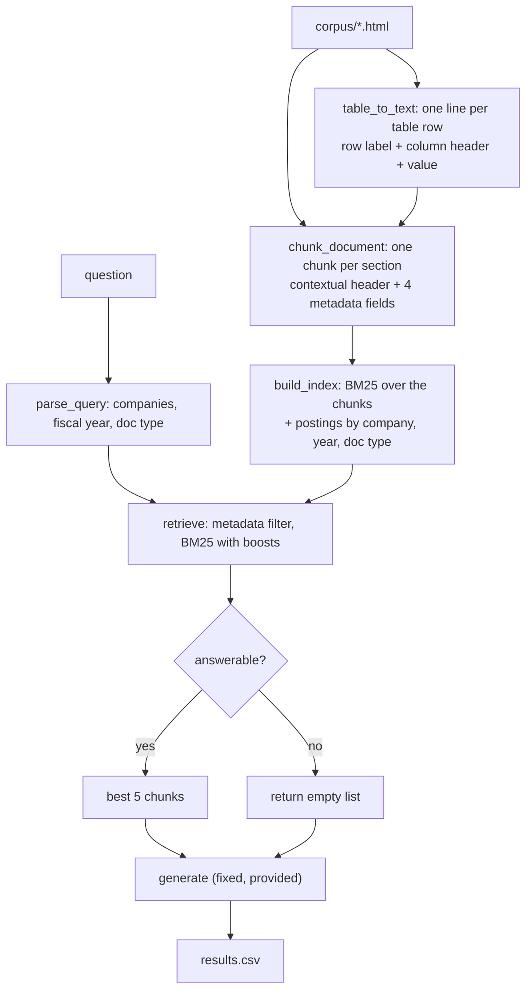

# FTEC5660 Homework 4 — the retrieval half of a RAG assistant over company reports

An equity-research desk asks short factual questions about fictional companies ("What were Northgate
Robotics' net accounts receivable at 31 December 2025?"). The generator that writes the answer is fixed
and given; everything that decides **what the generator sees** is in this repository: HTML table parsing,
chunking with metadata, query parsing, lexical retrieval with at most five chunks, and abstention when the
library cannot answer.

Public-set result, one run of `python3 hw4.py --data-folder public_test` (three consecutive runs identical):

| Task | 1.1 | 1.2 | 2.1 | 2.2 | 2.3 | 3 | 4 | Total |
|---|---|---|---|---|---|---|---|---|
| Points | 8.00 / 8 | 7.00 / 7 | 5.00 / 5 | 10.00 / 10 | 15.00 / 15 | 7.86 / 10 | 20.00 / 20 | **72.86 / 75** |

All 60 public answers are correct (60/60: 46 answerable answered, 14 unanswerable answered `NOT_FOUND`);
recall@5 is 100% on the answerable questions; a full run takes about 6 s and costs about USD 0.008 in
generator tokens.

## Quick start

```bash
git clone https://github.com/YUTING-FU-123/FTEC5660-HW4.git
cd FTEC5660-HW4
python3 -m venv .venv && source .venv/bin/activate
pip install -r requirements.txt

echo "DEEPSEEK_API_KEY=your_key_here" > .env      # never committed (.gitignore)
python3 hw4.py --data-folder public_test          # writes results.csv and prints the scores
```

Requirements: Python 3.10+; `rank-bm25`, `beautifulsoup4`, `lxml`, `langchain-*`, `python-dotenv`
(no embedding model and no vector store — retrieval is purely lexical, as the handout requires).

Because the harness that runs the grader may export its own `PYTHONPATH`, the reliable invocation on a
machine like mine is `env -u PYTHONPATH .venv/bin/python hw4.py --data-folder public_test`.

## Repository layout

```
hw4.py                     the five functions I wrote (top of file) + the provided code below the line
requirements.txt           langchain-*, beautifulsoup4, lxml, rank-bm25, python-dotenv
public_test/               40 documents of 10 companies, 60 questions, answers and evidence
tools/check_tables.py      Task 1.1 score of table_to_text, table by table
tools/eval_parse.py        Task 2.2 score of parse_query, question by question
tools/diagnose.py          per-question retrieval/answer diagnosis and failure-mode counts
tools/rank_probe.py        rank of the evidence chunk: why a question missed
tools/abstain_probe.py     the abstention trade-off, sorted by coverage
tools/ablate.py            the ablation study (writes tools/ablation.csv)
tools/ablation.csv         the numbers in the table below
FTEC5660_HW4_Reflection_YutingFu.pdf   Task 6 reflection (same text as the section at the end)
```

---

# Homework 4 solution

## 1. The pipeline



A document is parsed once: `table_to_text` turns every `<table>` into one line per row in which the row
label, the column header and the printed value stay together, and `chunk_document` walks the document in
reading order and cuts it on the section headings, so a balance sheet is never split across two chunks.
Each chunk carries `source`, `company`, `fiscal_year`, `doc_type` (required) plus the section title and the
kind of block it came from, and begins with a one-line header naming all of them. `build_index` builds a
BM25 index over the chunks and three postings lists (company, fiscal year, document type). `retrieve` asks
`parse_query` what the question is about, restricts the candidates with those postings, scores the rest
with BM25 plus a few multipliers (does this document print the asked year, is it the asked document type,
is the asked item named in this chunk, does the section title name it, is it a table for a figure
question), and either returns the best five chunks or nothing.

The public corpus becomes **865 chunks** (625 prose, 240 tables), median 287 characters, longest 1,498;
a document yields between 6 and 37 chunks.

## 2. The five functions

| Function | What it does |
|---|---|
| `table_to_text` | One line per table row: `Revenue \| 2025: 2,710.4 \| 2024: 2,629.1`. Caption kept (it holds the unit), section rows kept as their own line, values never reformatted. Splits a row into one line per value only if it would exceed 400 characters. |
| `chunk_document` | Section-level chunks with a header line `[company \| FY \| doc_type \| section]`; a table is its own chunk when it fits, and is packed line by line when it does not. Prose is split on whitespace with a 200-character overlap. |
| `parse_query` | Companies: longest-first match against a gazetteer built from the corpus metadata as `chunk_document` runs, plus near-miss names whose first word matches a corpus company (`Northgate Robotic Systems`), minus brokers and audit firms. Year: `FY2025`, `31 December 2024`, `in 2023`. Doc type: earnings-call and research-report keywords, otherwise annual report. |
| `build_index` | BM25 (`rank_bm25`) over stemmed, number-normalised tokens (`1,574.7` also indexes as `1574.7`) plus postings lists and per-chunk term fingerprints. |
| `retrieve` | Parse, filter by metadata (soft: relax the doc type, then the year, if the filter leaves fewer than three chunks), score with BM25 and the multipliers above, merge per company for comparison questions, then abstain or return 5. |

Rules respected: no embedding model anywhere; `table_to_text` and `chunk_document` never touch the model
(the runner verifies this and reports `llm_calls: 0` for the whole non-generator run); no file name, company
name, question or answer is hard-coded — the company names come from the corpus at run time.

## 3. Ablation study

`tools/ablate.py` runs the same code with one component switched at a time (environment switches read by
`hw4.py`). Each row is the previous row plus one change.

| Config | Change | 1.1 | 1.2 | 2.1 | 2.2 | 2.3 | 3 | 4 | recall@5 | answer acc. | Total /75 |
|---|---|---|---|---|---|---|---|---|---|---|---|
| **B0** | naive RAG: `get_text()`, `RecursiveCharacterTextSplitter`, BM25 top-5 over the whole corpus, no query parsing, never `[]` | 0.00 | 7.00 | 5.00 | 10.00 | 0.00 | 0.00 | 9.00 | 28.3% | 45.0% | 31.00 |
| **V1** | + `table_to_text` | 8.00 | 7.00 | 5.00 | 10.00 | 0.00 | 0.00 | 9.00 | 28.3% | 45.0% | 39.00 |
| **V2** | + section chunks with a contextual header | 8.00 | 7.00 | 5.00 | 10.00 | 13.04 | 0.00 | 16.00 | 84.8% | 80.0% | 59.04 |
| **V3** | + `parse_query` and metadata filtering | 8.00 | 7.00 | 5.00 | 10.00 | 15.00 | 7.14 | 20.00 | 100% | 100% | 72.14 |
| **V4** | + per-company retrieval for comparisons | 8.00 | 7.00 | 5.00 | 10.00 | 15.00 | 7.14 | 20.00 | 100% | 100% | 72.14 |
| **V5** | + abstention gates | 8.00 | 7.00 | 5.00 | 10.00 | 15.00 | 7.86 | 20.00 | 100% | 100% | **72.86** |
| V6 | + LLM answerability check | 8.00 | 7.00 | 4.35 | 10.00 | 13.86 | 8.70 | 18.00 | 87.0% | 90.0% | 69.90 |

**B0 → V1 (+8.00).** Parsing the tables correctly earns Task 1.1 outright, but recall does not move at all
(28.3% in both rows): the baseline chunker still calls `get_text()` on the whole body, so the converted
tables never reach the index. This is the cleanest lesson of the study — a better parser is worth nothing
until the chunker uses it.

**V1 → V2 (+20.04).** Making each table its own chunk, with a header naming the company, the fiscal year
and the document type, is what moves the numbers: recall 28.3% → 84.8%, answer accuracy 45% → 80%. Under
B0 a figure such as `2,710.4` arrives as a stream of digits with no row label next to it, so BM25 has nothing
to match "revenue" against; and five chunks of the flattened text almost always come from one company.

**V2 → V3 (+13.10).** Metadata filtering takes recall from 84.8% to 100% and accuracy to 100%, and it also
starts Task 3 (0 → 7.14) because the year gate rejects FY2021 and FY2022 before retrieval. This is the two
confusions the handout warns about: `Northgate Robotics` and `Northgate Payments` share a word, and every
report prints two years, so word frequency alone cannot separate them while a posting list can.

**V3 → V4 (0.00 on public).** Honest result: on the public set the per-company merge changes nothing,
because metadata filtering has already restricted the candidates to the two companies named in a
comparison, and the five slots happen to cover both. I kept it because it is the guarantee the public set
cannot demonstrate: if one company's chunks score higher, the round-robin merge still reserves a slot for
the other, which is what the private set (same structure, different wording) may need. I would rather
report the null result than claim a win.

**V4 → V5 (+0.72).** The abstention gates add the third kind of unanswerable question — a figure that is
never disclosed. Coverage of the asked words is 0.20 for "carbon offset purchases" and at least 0.44 for
every answerable question, so a threshold of 0.30 separates them with margin on both sides and costs no
answerable question.

**V5 → V6 (−2.96, rejected).** An LLM answerability check ("does the context state this item?") does reach
100% rejected, but it also throws away six answerable questions (kept 100% → 87%): the figure is in the
fifth chunk or below the 900-character excerpt it is shown, so the check answers NO about a corpus that does
answer. It also costs 43 s against 6 s. It is in the code behind `HW4_LLM_CHECK=1` and off by default,
because the measurement says it is worse.

## 4. Error analysis

The remaining 2.14 points are entirely in Task 3 (rejected 78.6% = 11 of 14). Three unanswerable questions
still receive chunks:

| Question | Why the gate misses it |
|---|---|
| "Brightwater Energy's **lobbying expenses** in FY2025" | `expenses` appears in the income statement, so coverage is 0.50 — half the asked words are present even though the item is not. |
| "Northgate Robotics' **largest single customer**" | `customer` and `largest` both occur somewhere in the annual report (risk factors discuss customer concentration), so coverage is 0.50. |
| "Halcyon Freight's **customer churn rate**" | `customer` and `rate` occur, `churn` does not; coverage 0.80, above the threshold. |

Task 4 survives this: the five retrieved chunks contain no such line, and the fixed generator answers
`NOT_FOUND` from what it sees — so all fourteen unanswerable questions are answered correctly even when
retrieval does not abstain. That is the reason the threshold is tuned lenient (0.30) rather than strict:
being too eager to abstain costs a task-4 answer worth 0.33 points *and* a task-3 `kept` point, which is
more than the 0.71 points a missed rejection costs.

Two failures I expect on the private set, and cannot test here:

1. **An unknown company whose first word matches nothing in the corpus.** My near-miss rule fires on
   `Northgate Robotic Systems` because `Northgate` is a corpus company's first word. A private question
   about "Ashcombe Marine" when no corpus company starts with "Ashcombe" would not be flagged, five chunks
   of some other company would come back, and the generator could answer with their figure.
2. **A comparison phrased so that one company is not capitalised** (or is referred to as "the second
   company"). `parse_query` would return one company and the merge would not reserve a slot for the other.

## 5. Reproducing these numbers

```bash
env -u PYTHONPATH .venv/bin/python hw4.py --data-folder public_test       # 72.86 / 75
env -u PYTHONPATH .venv/bin/python tools/check_tables.py                  # Task 1.1, 12 tables
env -u PYTHONPATH .venv/bin/python tools/eval_parse.py -v                 # Task 2.2, 60 questions
env -u PYTHONPATH .venv/bin/python tools/diagnose.py                      # failure modes
env -u PYTHONPATH .venv/bin/python tools/ablate.py                        # the table above
```

---

# Task 6 — Reflection: the person I want to be when the agents are better than me

The question assumes a future where an agent can write, program, research, run a business and make
decisions. I have spent this term building small pieces of exactly that, and the piece I keep thinking about
is the least impressive one: retrieval. My homework agent does not reason. It decides what a better model is
allowed to read, and then the model answers. When the answer is wrong, it is almost always because the right
passage never arrived — not because the reader was weak. I find that a useful thing to have learned before
the future arrives, because it says something about where a person still fits: not in producing the answer,
but in choosing what is worth looking at, and in noticing when the answer came from nowhere.

**What kind of person I want to be.** I want to be someone whose judgement is worth consulting, not someone
whose output is worth buying. Those are different things and only one of them survives better models. A
person whose judgement is worth consulting has usually paid for it: they have been in the room when a number
turned out to be wrong, they know which of their own conclusions they do not trust, and they can say "I do
not know" without it costing them anything. I would like to be the person in a meeting who is asked "does
this make sense?" rather than the person who is asked to produce the deck.

**Which ambitions still matter.** The ambitions that are really about other people survive: wanting the
research I hand to someone to be something they can rely on; wanting to be the colleague who does not
overstate a result. The ambitions that are about rank — the title, being the one who did it — look thinner
every month, because the thing that used to earn them (being able to produce a competent document quickly)
is now cheap. I am not going to pretend I no longer care about those; I care less than I did, and I notice
the difference.

**What I want to be known for beyond productivity.** For being accurate, and for admitting when I was not.
The most useful thing I did this term was not the code that scored well; it was the run where I found that my
first rule disagreed with the public answers and had to conclude that my definition, not the answer key, was
wrong. That habit — treating a disagreement as information about myself rather than about the other side —
is what I would like people to associate with me. Also, less grandly: for being good company on a long
problem. Most of the work worth doing is tedious in the middle.

**What I am willing to struggle for.** Two things. Understanding something well enough to explain it without
notes, because that is the difference between having read something and knowing it. And the parts of finance
that are still judgement rather than calculation: whether a business will still be earning in ten years,
whether management is telling you the truth in a way that a database cannot check. In the homework the
database could settle almost everything, and I deliberately chose points that the data could settle. That was
the right engineering decision and it is not the work I want to spend a career on. The scuttlebutt points —
talking to a customer, weighing a source who has an interest in the answer — are the ones an agent can help
with but cannot take over, and they are the ones I would rather be bad at for a while than skip.

**What still makes me valuable.** Not speed. Probably three things: taste in what to work on, the ability to
tell a plausible answer from a verified one, and the willingness to sit with an ambiguous situation instead
of resolving it prematurely. The last one is underrated. My agent resolves every ambiguity immediately and
confidently, which is exactly the failure mode I named in the previous reflection as psychosis: a coherent
story standing in for evidence. A person who can hold "I do not know yet" for a week without inventing an
answer is doing something the system cannot.

**If my value is not what I can do, how do I define who I am.** By what I notice, who I am responsible for,
and what I refuse to do. Those three are more stable than a skill set. I would add one more, smaller: by what
I am like to work with. If output stops being the currency, character becomes the currency, and character is
mostly visible in ordinary moments — whether you say the number is uncertain, whether you credit the person
who found the error, whether you finish the boring part.

**What I should do differently tomorrow.** Three concrete things. Read the source document before the
summary, always, even when the summary is good — that is the human version of not letting retrieval decide
for me. Write down what I expect before I run the thing, so that a surprise is visible as a surprise. And
answer one question a week from first principles, by hand, that I could have answered with a tool: not
because the tool is wrong, but because the capacity to check it is the thing I would lose first and miss
most.

None of this is a plan to be irreplaceable. I do not think people are irreplaceable, and the homework is a
good argument for that: the part of the job that was "produce an answer" is already a solved problem for
these questions. What is not solved is knowing which questions are worth asking and whether the answer is
true. Those are the parts I would like to be good at, and neither of them can be delegated to something that
does not care whether it is right.

---

## Notes on the rules

- No embedding model, no vector store, no web search, no other data source: retrieval is BM25 over the
  corpus the runner passes in, filtered with metadata derived from the documents themselves.
- `table_to_text` and `chunk_document` make no model calls (the runner prints the token counters for the
  whole run; mine are zero until the generator starts).
- No index file is committed: `build_index` runs from the corpus on every run (about 0.5 s for 40 documents).
- `.env` is git-ignored; the code reads `DEEPSEEK_API_KEY` from the environment, so the grader's own key wins.
- No file name, company name, question or answer is hard-coded anywhere: the company gazetteer
  `parse_query` uses is filled from the corpus metadata while `chunk_document` runs.

*AI tools were used to help design and implement the code, to run the ablation study and to draft this
write-up; every number quoted here comes from the runs in `tools/ablation.csv` and `results.csv`, and I
re-ran and checked them myself.*
